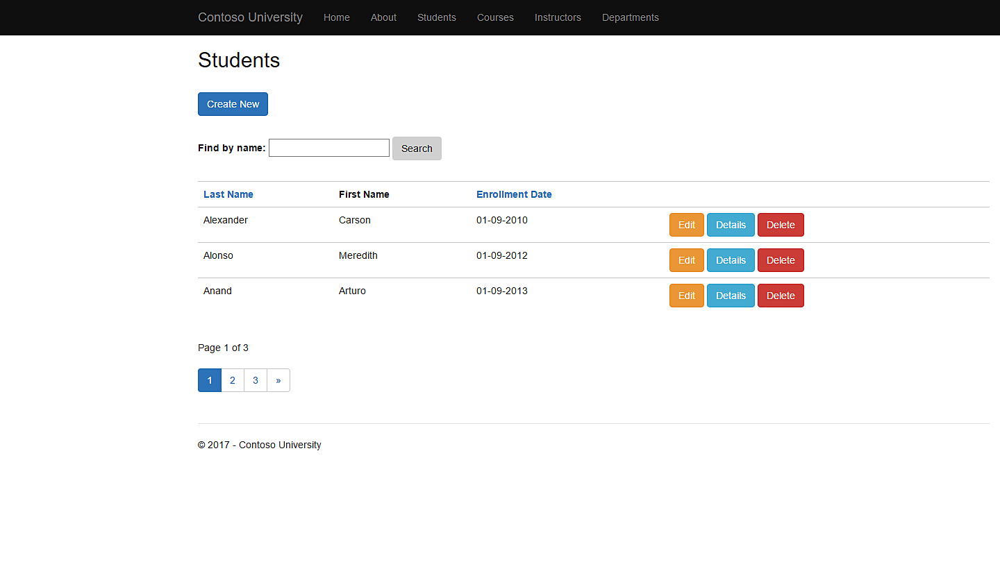

# University Admin Website 

## Asp.net MVC 5 with Entity Framework

Full CRUD operation ASP.NET MVC 5 framework intergrated with Entity Framework 6 SQL database. 
Add edit update and delete 
> Students 
>
> Courses
> 
> Instructors
> 
> Room bookings.

## Project preview

## Migration notes (ASP.NET MVC 5 / .NET Framework 4.7 -> ASP.NET Core MVC on .NET 10)

- Single SDK-style project `ContosoUniversity/ContosoUniversity.csproj` targeting `net10.0`.
- Startup lives in `Program.cs`; configuration in `appsettings*.json` (connection string `ConnectionStrings:SchoolContext`).
- Data access uses EF Core 10 (`DAL/SchoolContext.cs`) with explicit singular table names and the `CourseInstructor` join table.
- A fresh `InitialBaseline` migration is in `Migrations/`. For an existing EF6 database, mark it as applied instead of running it
  (insert `20261123114032_InitialBaseline` / `10.0.0` into `__EFMigrationsHistory`) or set `Database:InitializeOnStartup` to `false`.
- Sample data is seeded by `DAL/DbInitializer.cs` when the `Student` table is empty.
- Client libraries (jQuery 3.7.1, Bootstrap 3.4.1, jquery-validation 1.19.5, unobtrusive 4.0.0) are in `wwwroot/lib` (see `libman.json`).
- The application is anonymous, as in the legacy version; add authentication/authorization before exposing it publicly.
