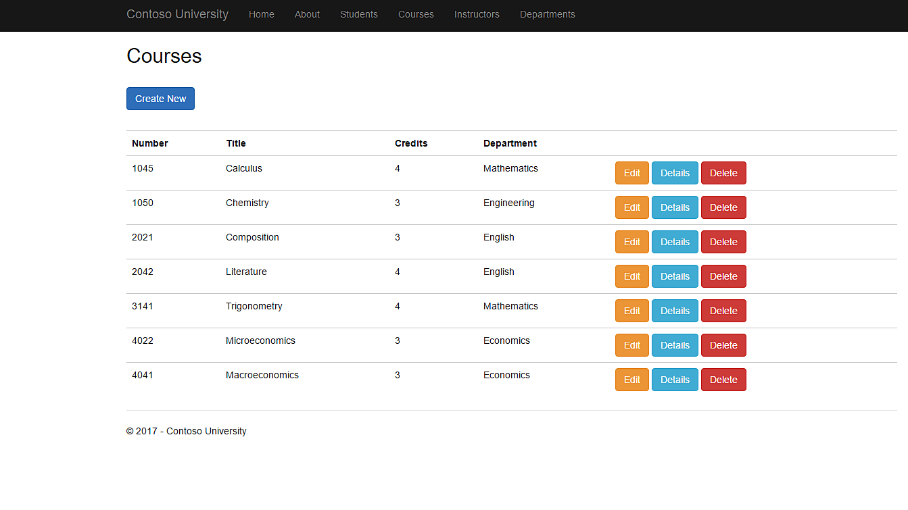

# University Admin Website 

## ASP.NET Core MVC (net8.0, Linux container ready) with Entity Framework 6

Configuration (environment variables): `ConnectionStrings__SchoolContext` or `DB_HOST`, `DB_NAME`, `DB_USER`, `DB_PASSWORD`. Health check: `GET /health`.

Full CRUD operation ASP.NET MVC 5 framework intergrated with Entity Framework 6 SQL database. 
Add edit update and delete 
> Students 
>
> Courses
> 
> Instructors
> 
> Room bookings.

## Project preview

