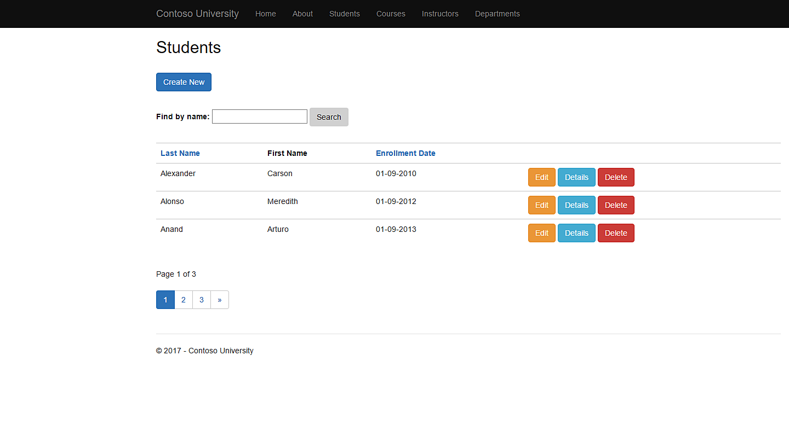
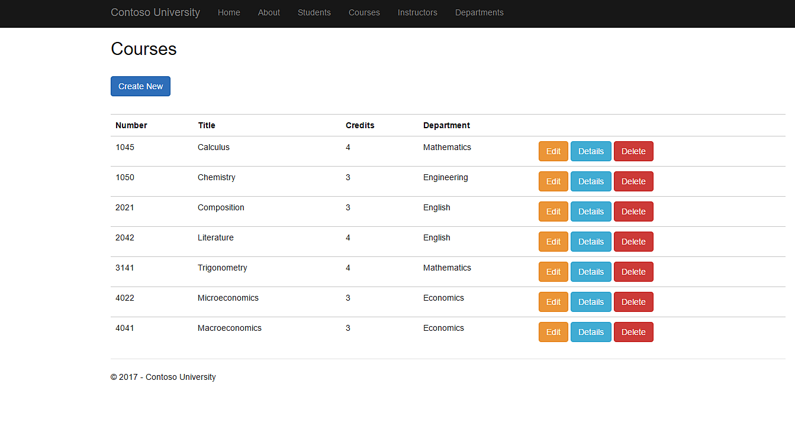

# University Admin Website 

## Asp.net MVC 5 with Entity Framework

Full CRUD operation ASP.NET MVC 5 framework intergrated with Entity Framework 6 SQL database. 
Add edit update and delete 
> Students 
>
> Courses
> 
> Instructors
> 
> Room bookings.

## Project preview

## ASP.NET Core (.NET 10) migration notes

- Single ASP.NET Core MVC project: `ContosoUniversity/ContosoUniversity.csproj` (`net10.0`). Build with `dotnet build ContosoUniversity.sln`.
- Connection string: `ConnectionStrings:SchoolContext` in `appsettings.json` (defaults to the database name EF6 used: `ContosoUniversity.DAL.SchoolContext`).
- EF Core migration `InitialBaseline` models the existing schema. For a database previously created by EF6, do NOT run it; instead mark it as applied:
  `INSERT INTO __EFMigrationsHistory (MigrationId, ProductVersion) VALUES ('20261112152948_InitialBaseline', '10.0.0')`
  (create the `__EFMigrationsHistory` table first with `dotnet ef migrations script` if needed). The old `__MigrationHistory` table can be left alone.
- In Development, `Database:InitializeOnStartup` is true: migrations are applied and `DbInitializer` seeds an empty database.
